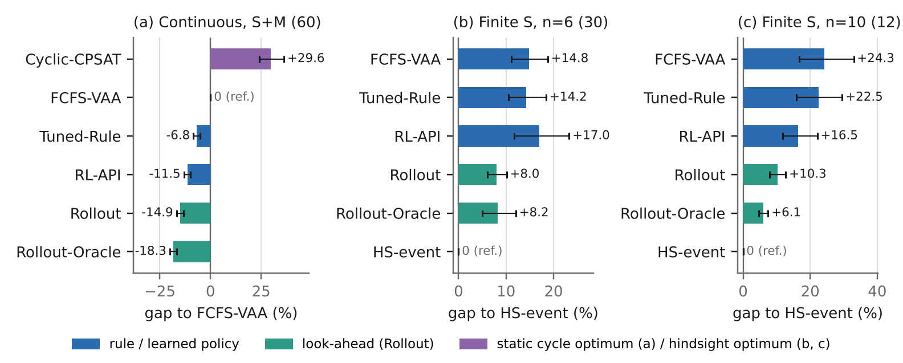

# C2 격차 분해 정리 (research/rl)

작성 2026-11-02. 기여 C2("구조적 결론과 격차 분해")의 표와 그림. 새 시뮬레이션 없이 고정된 결과 두 개를 다시 묶었다.

- 연속 스트림: `outputs/stream_eval.jsonl` (시험 풀, S·M 60개 스트림)
- 유한 인스턴스: `outputs/stream_hindsight.jsonl` (사후 최적 풀, S, n = 6 트럭 30개, n = 10 트럭 12개)
- 스크립트 `experiments/stream_gap_decomposition.py` → 표 `outputs/stream_gap_decomposition.txt`,
  그림 `paper/figures/stream_gap_decomposition.{pdf,png}`

**계산 방식.** 모든 단(rung)은 인스턴스별로 같은 기준(연속은 FCFS-VAA, 유한은 HS-event)에 대한 비율이다. 그래서 단 사이의 차이(단계)를
더하면 전체 격차와 정확히 같다. 단계마다 짝지은 부트스트랩 95% 신뢰구간(인스턴스 재표본 10,000회)과 Wilcoxon 부호 순위 p를 붙였다.
5.6절의 "HS-event 평균 대비 %"와는 정규화가 달라 숫자가 조금 다르다(예: n = 10 정보 기여 3.5% → 4.2 pp).

## 1. 연속 스트림 (S·M 시험 60개, FCFS-VAA 대비 %)

| 단 | FCFS-VAA 대비 | 95% CI |
|---|---:|---|
| Cyclic-CPSAT (사이클별 최적해) | +29.6% | +23.9, +36.3 |
| FCFS-VAA | 0 | |
| Tuned-Rule | −6.8% | −8.5, −5.2 |
| RL-API | −11.5% | −13.1, −9.9 |
| Rollout | −14.9% | −16.8, −13.2 |
| Rollout-Oracle (실제 미래) | −18.3% | −20.1, −16.6 |

| 단계 | 크기 (pp) | 95% CI | 줄어든 스트림 | p |
|---|---:|---|---:|---:|
| 정적 틀 (Cyclic-CPSAT → FCFS-VAA) | 29.6 | 23.8, 36.1 | 60/60 | 1.6e-11 |
| 규칙 튜닝 (→ Tuned-Rule) | 6.8 | 5.2, 8.5 | 52/60 | 2.1e-9 |
| 학습 정책 (→ RL-API, 같은 정보의 비선형 판단) | 4.7 | 3.8, 5.5 | 56/60 | 7.2e-10 |
| 증류 손실 (RL-API → Rollout) | 3.5 | 2.2, 4.9 | 55/60 | 2.3e-10 |
| 정보 (Rollout → Rollout-Oracle) | 3.4 | 3.1, 3.7 | 60/60 | 1.6e-11 |

- 정적 틀의 손실은 부하에 따라 커진다(ρ = 0.5 / 0.6 / 0.7에서 +12.2 / +24.9 / +51.7%). 규모별로는 S +27.6%, M +31.6%.
- Rollout 이득은 M(−16.5%)이 S(−13.4%)보다 크고, 고부하(ρ = 0.7, −17.8%)에서 가장 크다.
- 연속 스트림에는 사후 최적이 없어서 Rollout-Oracle 아래(최적화 격차)는 유한 인스턴스로 잰다.

## 2. 유한 인스턴스 (S, HS-event 대비 %)

| 단 | n = 6 (30) | n = 10 (12) |
|---|---:|---:|
| FCFS-VAA | +14.8% [11.1, 18.8] | +24.3% [16.8, 32.7] |
| Tuned-Rule | +14.2% | +22.5% |
| RL-API | +17.0% | +16.5% |
| Rollout | +8.0% [6.1, 10.1] | +10.3% [7.9, 12.6] |
| Rollout-Oracle | +8.2% [5.0, 12.0] | +6.1% [4.8, 7.5] |
| HS-event | 0 | 0 |

| 단계 | n = 6 | n = 10 |
|---|---|---|
| 미리 보기 (FCFS-VAA → Rollout) | 6.8 pp [3.4, 10.4], 21/30, p = 0.0014 | 14.0 pp [5.8, 22.5], 10/12, p = 0.0093 |
| 정보 (Rollout → Oracle) | −0.2 pp [−3.0, 2.3], 18/30, p = 0.74 | 4.2 pp [1.9, 6.8], 11/12, p = 0.0034 |
| 최적화 (Oracle → HS-event) | 8.2 pp [5.0, 12.0], 29/30, p = 2.6e-6 | 6.1 pp [4.8, 7.5], 12/12, p = 0.0005 |
| Rollout 격차 중 정보 / 최적화 비중 | 0% / 100% | 41% / 59% |

**행동 공간 점검.** HS-event는 도킹을 도착·출발 시점으로 제한한 사후 최적이다. n = 6에서 HS-event와 자유 시각 완화가 둘 다 최적으로
증명된 15개 인스턴스에서 차이는 평균 +0.61%(최대 +6.06%)였다. 즉 사건 정렬 제한은 거의 손해가 없고, HS-event는 진짜 사후 최적에
가깝다. 따라서 최적화 격차는 행동 공간 제한 때문이 아니다. n = 10은 증명된 인스턴스가 없어 HS-event는 찾은 최선이며, 진짜 격차는 표보다
클 수 있다.

## 3. 결론 (논문 문장 후보)

1. **가장 큰 손실은 정적 틀이다.** 사이클마다 최적해를 구해도 상태 기반 규칙보다 29.6% 나쁘고(60/60), 부하가 높을수록 커진다.
   풀이기를 좋게 해서는 줄지 않는다(5.4절: 사이클 최적 격차 0.06–0.63%의 차이가 운영 성능 1% 안).
2. **상태 기반 정책 안에서는 미리 보기가 가장 크다.** 규칙 튜닝 6.8 pp, 비선형 학습 4.7 pp, Rollout 3.5 pp가 차례로 더해진다.
   유한 인스턴스에서 Rollout은 규칙의 사후 최적 격차를 약 절반 줄인다(46%, 58%).
3. **남은 격차의 대부분은 정보가 아니라 최적화다.** Rollout과 사후 최적의 격차 8–10% 중 정보로 설명되는 것은 0–41%이고,
   나머지 6–8 pp는 미래를 알아도 한 단계 개선으로 닫히지 않는다.
   - 표본을 늘리거나(Rollout-32), 기본 정책을 바꾸거나(Rollout@api, 5.9), 사후 교사로 학습하거나(5.7) 행동을 늘려도(C3, 5.10) 닫히지 않았다.
4. **증류 손실(3.5 pp)과 정보 가치(3.4 pp)는 크기가 비슷하다.** 1 ms 정책을 쓰는 비용은 미래를 모르는 비용과 같은 수준이다.

그림 캡션 후보: "Gap decomposition. (a) Continuous streams: mean per-stream J/work relative to FCFS-VAA; consecutive rungs
add up to the total. (b, c) Finite S instances: gap to the best perfect-information schedule in the policy action
space (HS-event). Whiskers: paired bootstrap 95% CI."

## 4. 주의할 점

- 유한 인스턴스는 작고(트럭 6·10대) 끝 효과가 크다. RL-API는 연속 스트림으로만 학습해서 n = 6에서 FCFS보다 나쁘다. 유한 인스턴스는
  정책 순위가 아니라 격차 분해의 근거로만 쓴다.
- n = 6의 정보 단계는 0과 구분되지 않는다(p = 0.74). "정보 기여 0–41%"는 규모에 따라 정보의 몫이 커진다는 뜻으로 읽고, 인스턴스를 더 모아야
  추세라고 말할 수 있다.
- 연속 스트림과 유한 인스턴스는 기준이 다르므로 두 사다리를 하나의 축에 합치지 않는다.

## 5. 사후 편향 직접 측정 (2026-11-02)

스크립트 `experiments/stream_hindsight_bias.py`, 결과 `outputs/stream_hindsight_bias.{jsonl,txt}`,
그림 `paper/figures/stream_hindsight_bias.{pdf,png}`.

**설정.** tuning 12개 스트림에서 FCFS-VAA로 150결정 예열한 뒤 Rollout 교사가 240결정을 내리는 동안 두 결정마다 상태를 잡았다(1,440개).
상태마다 Rollout 후보(평균 6.4개)를 미래 40개에서 공통 난수로 1 SLA 동안 시뮬레이션했다(기본 정책 FCFS-VAA, 교사와 같은 조건).

- a* = 나중 미래 24개 평균 비용이 가장 낮은 행동(기대 비용 기준 최선의 추정)
- m개 레이블 = 앞 미래 16개를 m개씩 묶어 평균 비용 최소 행동. **m = 1이 사후 레이블**(미래 하나에 맞춘 최선 행동; fork 표본은 상태가 주어졌을 때
  실제 미래와 분포가 같으므로 5.7절의 실제 미래 교사와 같은 분포), m = 8이 Rollout 교사 레이블
- 정규화 후회 = (레이블 행동의 기대 비용 − a*의 기대 비용) / (후보를 무작위로 고를 때의 후회). 0이면 최선, 1이면 무작위 선택과 같다.
- 신뢰구간은 스트림 단위 부트스트랩(상태끼리의 상관 반영).

| 미래 수 m | a*와 일치 | 정규화 후회 |
|---:|---:|---:|
| **1 (사후 레이블)** | **54.7%** [50.3, 58.8] | **0.327** [0.286, 0.372] |
| 2 | 61.3% | 0.233 |
| 4 | 67.8% | 0.164 |
| **8 (Rollout 교사)** | **75.0%** [71.2, 78.1] | **0.104** [0.082, 0.131] |
| 16 | 79.5% | 0.075 |

- **사후 레이블의 후회는 Rollout 레이블의 약 3배다**(0.33 대 0.10). 사후 레이블은 무작위 선택 후회의 1/3을 잃는다.
- 미래 16개에서 사후 최선 행동이 평균 3.5가지로 갈린다(후보 6.4개 중). 같은 상태에도 레이블이 크게 흔들린다.
- 가치의 사후 편향 E_k min_a C − min_a E_k C는 무작위 선택 후회의 −0.48배[−0.56, −0.40]다. 미래를 알면 행동 선택만으로 그만큼 더 낮은 비용이
  가능해 보이지만, 그 행동은 미래마다 다르다.
- a*별: 기다림(HOLD)이 최선인 상태(9.1%)에서 사후 레이블 일치는 34.3%(Rollout 59.5%)로 가장 나쁘다. 앞 트럭 배정이 최선인 상태(82.8%)는 57.0%(76.3%).
- 실현된 다음 도착 시각과의 관계는 약하다. 다음 트럭이 일찍 / 중간 / 늦게 오는 미래에서 사후 레이블이 HOLD인 비율은 8.0 / 9.3 / 9.4%,
  a* 일치는 53.1 / 53.3 / 57.7%다(χ² p = 0.006이지만 한 상태의 레이블 16개를 따로 셌으므로 증거가 과장됨).
  → 레이블 잡음은 "다음 트럭이 언제 오는가" 하나가 아니라 1 SLA 동안의 미래 전체(도착 순서, 화물 구성)에서 나온다.

**5.7절 결과와의 연결.** 사후 교사 증류(tuning 1.759)가 Rollout 교사 증류(1.680)보다 나빴던 이유가 레이블 품질로 설명된다.
미래 하나에 맞춘 레이블은 상태만 보는 정책 입장에서 무작위 오차가 큰 레이블이다(일치 55%, 후회 3배). 사후 학습 이론(Sinclair et al. 2022)이
기대는 "사후 편향이 작다"는 전제가 이 문제에서는 성립하지 않는다(편향이 행동 간 기대 비용 차이의 약 절반). 반대로 m을 늘리면 품질이 단조롭게
좋아지므로 증류 교사로는 표본 평균(Rollout)이 맞다. 다만 m = 16에서도 일치 80%라 표본 수를 더 늘리는 이득은 작다(Rollout-32가 효과 없던 것과 같은 방향).

**한계.** a*도 미래 24개로 추정한 값이라 일치율의 천장은 100%보다 낮다(m = 16에서 79.5%). 비교는 m 사이의 상대 차이로 읽는다.
상태는 Rollout이 방문한 상태라 RL-API의 DAgger 상태 분포와 다를 수 있다.

## 6. 남은 C2 작업

- n = 10 인스턴스 추가(현재 12개)와 증명 시간 확대.
- 논문 C2 절 초안: 격차 분해 그림 + 사후 편향 그림을 묶어 "왜 한 단계 개선에서 멈추는가"를 서술.
